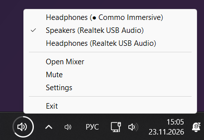

# Volume Mixer for Windows 11

A native C++20 and WinUI 3 volume mixer with vertical faders for your output device and individual apps. Adjusting the master volume preserves each app's volume setting.

[](https://github.com/artnway/VolumeMixer/releases/latest/download/VolumeMixer-Setup-x64.exe)

[Install](#install) · [Screenshots](#screenshots) · [Controls](#controls) · [Build from source](#build-from-source) · [Credits](#credits) · [Telegram](https://t.me/Artnwayclub)

## Install

1. Download [VolumeMixer-Setup-x64.exe](https://github.com/artnway/VolumeMixer/releases/latest/download/VolumeMixer-Setup-x64.exe).
2. Run it on **Windows 11 x64**. Setup installs Volume Mixer for your account and adds it to the Start menu.

The installer is unsigned, so Windows SmartScreen may show a warning. [Release notes](https://github.com/artnway/VolumeMixer/releases/latest)

## Screenshots


- **Mixer backgrounds** · [Mica Alt](Screenshots/Publication-Preview/mixer-Mica.png) · [Acrylic](Screenshots/Publication-Preview/mixer-Acrylic.png) · [Clear Glass](Screenshots/Publication-Preview/mixer-ClearGlass.png) · [Liquid Glass](Screenshots/Publication-Preview/mixer-LiquidGlass.png)
- **Settings** · [General](Screenshots/Publication-Preview/settings-General.png) · [Taskbar](Screenshots/Publication-Preview/settings-Taskbar.png) · [Mixer](Screenshots/Publication-Preview/settings-Mixer.png) · [Devices](Screenshots/Publication-Preview/settings-Devices.png) · [Shortcuts](Screenshots/Publication-Preview/settings-Shortcuts.png) · [Color Picker](Screenshots/Publication-Preview/settings-ColorPicker.png)
- **Taskbar** · [Speaker ring](Screenshots/Publication-Preview/taskbar-IconOnly.png) · [Numeric ring](Screenshots/Publication-Preview/taskbar-VolumePercentage.png) · [Right-click menu](Screenshots/Publication-Preview/taskbar-context-menu.png)



## Controls

- Click the taskbar widget or tray icon to toggle the mixer. Right-click for output devices, mute, and Settings.
- The taskbar ring shows master volume around a speaker icon or a number from 0 to 100. Scroll over the widget to adjust volume, hold Ctrl while scrolling to switch devices, or middle-click to toggle mute. The default volume step is 2%.
- In the mixer, click the output device icon to cycle through devices or right-click to see the list. In **Settings → Devices**, you can hide outputs and reorder favorites. Disconnected outputs are skipped. Without favorites, cycling uses all available visible outputs.
- Open an app channel's menu to enter a volume, pin the channel, or hide it. You can reorder pinned channels. If an app has multiple audio sessions, its fader and meter show the highest volume and peak, respectively. Moving the fader adjusts all of that app's current sessions.
- The mixer opens at the right edge of the monitor's work area. Drag a blank area to move it or drag an edge or corner to resize it. Its position and size are saved. The dot in the upper-right corner turns white when the mixer is pinned.
- **Apply** in Settings saves changes without closing the window. In **Settings → Shortcuts**, select a field and press a key combination. Delete or Backspace clears it. The default shortcut for the next output device is `Ctrl+Alt+V`.

The white knob shows the set volume. In silence the track is translucent. During playback, the gray meter shows the peak before the volume control and the accent-colored meter shows the estimated peak after it. For the output device, the estimate accounts for the endpoint gain in decibels. [Microsoft Core Audio peak meter documentation](https://learn.microsoft.com/en-us/windows/win32/api/endpointvolume/nn-endpointvolume-iaudiometerinformation)

### Backgrounds

Mica Alt is the default. Choose **Acrylic**, **Clear glass**, or **Liquid glass** under **Settings → Mixer → Background material**. **Tint color** and **Background opacity** control the tint. **Glass frost** adjusts the blur in Liquid Glass. **Track length** changes the fader length and mixer height.

Clear Glass uses a transparent WinUI brush and DWM. Liquid Glass uses Direct3D 11 shaders to refract and blur a desktop capture while the mixer is open. Windows excludes the mixer window from screenshots and screen recordings while Liquid Glass is active. If desktop capture is unavailable, the mixer falls back to a transparent background. [LiquidGlassWinUI](https://github.com/luckyelysia/LiquidGlassWinUI) · [Shader license](UI/LiquidGlassWinUI/LICENSE)

Settings are stored in `%LOCALAPPDATA%\VolumeMixer\settings.json`.

### Taskbar compatibility

The widget is a transparent Win32 window positioned in Explorer's taskbar next to the notification area. It checks the taskbar layout via UI Automation on a separate MTA thread. The ring shrinks when space is limited. The mixer stays accessible through the tray when there is too little space, the layout is unsupported, or taskbar auto-hide is enabled. If the widget does not receive mouse wheel input, enable scrolling over inactive windows in Windows mouse settings. [UI Automation threading](https://learn.microsoft.com/en-us/windows/win32/winauto/uiauto-threading)

Switching the default audio device uses the undocumented PolicyConfig interface, isolated in `Audio/PolicyConfigAdapter.cpp`. The active roles are verified through MMDevice after switching. [Implementation and test notes](IMPLEMENTATION.md)

## Build from source

Use Visual Studio 2022 with **Desktop development with C++**, Windows SDK 10.0.26100.0, and the NuGet packages listed in `packages.config`. Run these commands from Developer PowerShell in the repository root.

```powershell
nuget restore VolumeMixer.sln
MSBuild VolumeMixer.sln /m /p:Configuration=Release /p:Platform=x64 /p:WindowsPackageType=None /p:WindowsAppSDKSelfContained=true /p:AppxPackage=false
```

### Build the installer

Build a self-contained x64 release into a separate directory, then package it using NSIS 3.13 or later. [NSIS download](https://nsis.sourceforge.io/Download)

```powershell
MSBuild VolumeMixer.sln /m /p:Configuration=Release /p:Platform=x64 /p:WindowsPackageType=None /p:WindowsAppSDKSelfContained=true /p:AppxPackage=false /p:OutDir=x64/InstallerPayload/
.\installer\Build-Installer.ps1 -PayloadDir .\x64\InstallerPayload -MakeNsis 'C:\Program Files (x86)\NSIS\makensis.exe'
```

The installer is written to `dist\VolumeMixer-Setup-x64.exe`.

## Credits

- **LiquidGlassWinUI** by luckyelysia provides the refraction and frost shaders. [Project](https://github.com/luckyelysia/LiquidGlassWinUI) · [MIT license](UI/LiquidGlassWinUI/LICENSE)
- **Tabler Icons** by Paweł Kuna and contributors provides the Adjustments artwork used for the app icon. [Icon](https://tabler.io/icons/icon/adjustments) · [MIT license](Assets/TablerIcons.LICENSE.txt)
- **BatteryHub** by krisgfx9, **TaskbarMonitor** by MaybeKrat, and **Deskband11Lib** by airtaxi served as technical references for the independently implemented taskbar widget. TaskbarMonitor also inspired the volume ring. [BatteryHub](https://github.com/krisgfx9/Wireless-Device-Battery-Monitor) · [BatteryHub archive](https://github.com/notjiccu/wireless-device-battery-monitor/tree/v1.0.4) · [TaskbarMonitor](https://github.com/MaybeKrat/TaskbarMonitor) · [Deskband11Lib](https://github.com/airtaxi/Deskband11Lib)

The installer includes the full third-party notices. [Third-party notices](THIRD_PARTY_NOTICES.txt)

## License

Volume Mixer is released under the MIT License. [License](LICENSE)
