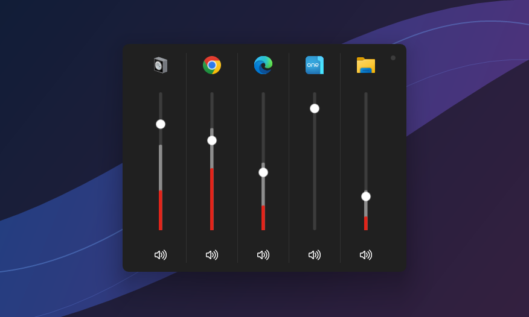

# Volume Mixer для Windows 11

Нативный микшер на C++20 и WinUI 3. Первый вертикальный фейдер управляет устройством вывода, остальные — приложениями. Изменение общей громкости сохраняет настройки отдельных приложений.

Белый бегунок показывает установленную громкость. В тишине дорожка целиком полупрозрачная. При воспроизведении серая полоса показывает пик до регулятора канала, а полоса системного акцентного цвета показывает расчётный пик после регулятора. Для устройства Core Audio измеряет пик до общей громкости, а шкала микшера учитывает усиление устройства в децибелах. [Документация Microsoft о пик-метре](https://learn.microsoft.com/en-us/windows/win32/api/endpointvolume/nn-endpointvolume-iaudiometerinformation)

## Установка

Скачайте `VolumeMixer-Setup-x64.exe` в разделе **Releases** и запустите на Windows 11 x64. Приложение устанавливается для текущего пользователя и появляется в меню «Пуск». Windows SmartScreen может показать предупреждение, поскольку установщик без цифровой подписи.

## Скриншоты



- **Фоны микшера** · [Mica Alt](Screenshots/Publication-Preview/mixer-Mica.png) · [Acrylic](Screenshots/Publication-Preview/mixer-Acrylic.png) · [Clear glass](Screenshots/Publication-Preview/mixer-ClearGlass.png) · [Liquid glass](Screenshots/Publication-Preview/mixer-LiquidGlass.png)
- **Настройки** · [General](Screenshots/Publication-Preview/settings-General.png) · [Taskbar](Screenshots/Publication-Preview/settings-Taskbar.png) · [Mixer](Screenshots/Publication-Preview/settings-Mixer.png) · [Devices](Screenshots/Publication-Preview/settings-Devices.png) · [Shortcuts](Screenshots/Publication-Preview/settings-Shortcuts.png) · [Color Picker](Screenshots/Publication-Preview/settings-ColorPicker.png)
- **Панель задач** · [Кольцо с иконкой](Screenshots/Publication-Preview/taskbar-IconOnly.png) · [Кольцо с числом](Screenshots/Publication-Preview/taskbar-VolumePercentage.png) · [Меню по правому клику](Screenshots/Publication-Preview/taskbar-context-menu.png)

## Управление

- Левый клик по виджету или значку в трее открывает и закрывает микшер. Правый клик открывает меню устройств, Mute и настройки.
- Кольцо в панели задач показывает общую громкость. В центре на выбор динамик с волнами или число от 0 до 100. Точка в правом верхнем углу закрепляет окно микшера и становится белой при закреплении.
- Над виджетом колесо меняет общую громкость, Ctrl с колесом переключает устройство, средний клик переключает Mute. По умолчанию шаг громкости — 2%.
- Левый клик по иконке устройства в микшере выбирает следующее устройство. Правый клик открывает список. В Settings можно скрыть выход из переключателя и поменять порядок избранных. Отсутствующие выходы пропускаются. Пока список избранного пуст, переключение охватывает доступные видимые устройства.
- Через меню канала можно ввести процент вручную, закрепить или скрыть приложение. Закреплённые каналы можно переставлять.
- При первом открытии окно прилегает к правому краю рабочей области монитора. Потяните за свободную область панели, чтобы переместить окно, или за край или угол, чтобы изменить размер. Положение и размер сохраняются для следующего запуска.
- Кнопка Pin в правом верхнем углу закрепляет окно. В настройках пять вкладок. **Apply** сохраняет и применяет изменения, оставляя настройки открытыми.
- По умолчанию фон использует Mica Alt. В **Settings → Mixer → Background material** доступны Acrylic, прозрачный **Clear glass** и **Liquid glass** с преломлением по краям. **Tint color** задаёт цвет тонировки во всех режимах. **Background opacity** регулирует её непрозрачность, а **Glass frost** изменяет размытие Liquid glass. Параметр **Track length** меняет длину дорожек и высоту микшера.
- В Settings → Shortcuts выберите поле и нажмите сочетание клавиш. Delete или Backspace очищает поле. Исходное сочетание для перехода к следующему устройству — `Ctrl+Alt+V`.

Clear glass использует прозрачную кисть WinUI и DWM. Liquid glass рендерит исходные шейдеры преломления и размытия LiquidGlassWinUI через Direct3D 11. DXGI получает фон позади микшера только пока его окно открыто. В Liquid glass Windows исключает окно микшера из скриншотов и записи экрана. При недоступном захвате показывается прозрачный фон. [LiquidGlassWinUI](https://github.com/luckyelysia/LiquidGlassWinUI) · [Лицензия шейдеров](UI/LiquidGlassWinUI/LICENSE)

Настройки сохраняются в `%LOCALAPPDATA%\VolumeMixer\settings.json`. Для приложения с несколькими сессиями фейдер показывает максимальный установленный уровень, а индикатор сигнала — максимальный текущий пик. Изменение приложенческого фейдера применяется ко всем текущим сессиям этого приложения.

## Сборка

Требуются Visual Studio 2022 с Desktop development with C++, Windows SDK 10.0.26100.0 и пакеты NuGet из `packages.config`. Из Developer PowerShell в каталоге проекта:

```powershell
nuget restore VolumeMixer.sln
MSBuild VolumeMixer.sln /m /p:Configuration=Release /p:Platform=x64 /p:WindowsPackageType=None /p:WindowsAppSDKSelfContained=true /p:AppxPackage=false
```

## Панель задач

Виджет — прозрачное дочернее Win32-окно панели задач Explorer рядом с системной областью. Разметка панели проверяется через UI Automation в отдельном MTA-потоке. При нехватке места виджет сначала пробует уменьшить кольцо. При отсутствии места для виджета, неподдерживаемой разметке или включённом автоскрытии доступ к микшеру остаётся через трей. Если Windows направляет колесо только активному приложению, виджету нужно разрешить прокрутку неактивных окон в системных настройках мыши.

Технические принципы размещения сверены с [BatteryHub](https://github.com/krisgfx9/Wireless-Device-Battery-Monitor), [TaskbarMonitor](https://github.com/MaybeKrat/TaskbarMonitor#how-it-works), [Deskband11Lib](https://github.com/airtaxi/Deskband11Lib) и [документацией UI Automation](https://learn.microsoft.com/en-us/windows/win32/winauto/uiauto-threading). Код виджета написан самостоятельно. Переключение устройства использует недокументированный PolicyConfig, изолированный в `Audio/PolicyConfigAdapter.cpp`. После переключения выбранные роли перепроверяются через MMDevice API.

Состояние реализации и результаты проверок — в [журнале](IMPLEMENTATION.md).

## Авторы компонентов и технические референсы

- **LiquidGlassWinUI** от luckyelysia — шейдеры преломления и матовости в режиме Liquid Glass. [Проект](https://github.com/luckyelysia/LiquidGlassWinUI) · [Лицензия MIT](UI/LiquidGlassWinUI/LICENSE)
- **Tabler Icons** от Paweł Kuna и участников проекта — иконка Adjustments, на основе которой сделан значок приложения. [Иконка](https://tabler.io/icons/icon/adjustments) · [Лицензия MIT](Assets/TablerIcons.LICENSE.txt)
- **BatteryHub** от krisgfx9, **TaskbarMonitor** от MaybeKrat и **Deskband11Lib** от airtaxi — технические референсы для виджета. У TaskbarMonitor также подсмотрели идею кольцевого индикатора. [BatteryHub](https://github.com/krisgfx9/Wireless-Device-Battery-Monitor) · [Архив BatteryHub](https://github.com/notjiccu/wireless-device-battery-monitor/tree/v1.0.4) · [TaskbarMonitor](https://github.com/MaybeKrat/TaskbarMonitor) · [Deskband11Lib](https://github.com/airtaxi/Deskband11Lib)

Полный список включён в установщик. [THIRD_PARTY_NOTICES.txt](THIRD_PARTY_NOTICES.txt)

## Сборка установщика

Соберите автономный Release x64 в отдельную папку и передайте её скрипту упаковки из Developer PowerShell. Для скрипта нужен [NSIS 3.13 или новее](https://nsis.sourceforge.io/Download).

```powershell
MSBuild VolumeMixer.sln /m /p:Configuration=Release /p:Platform=x64 /p:WindowsPackageType=None /p:WindowsAppSDKSelfContained=true /p:AppxPackage=false /p:OutDir=x64/InstallerPayload/
.\installer\Build-Installer.ps1 -PayloadDir .\x64\InstallerPayload -MakeNsis 'C:\Program Files (x86)\NSIS\makensis.exe'
```

Файл `dist\VolumeMixer-Setup-x64.exe` устанавливает приложение для текущего пользователя и добавляет его в меню «Пуск».

## Лицензия

Volume Mixer распространяется по лицензии MIT. Права на сторонние компоненты и их лицензии указаны в списке авторов. [Лицензия Volume Mixer](LICENSE) · [Список авторов и лицензий](THIRD_PARTY_NOTICES.txt)
